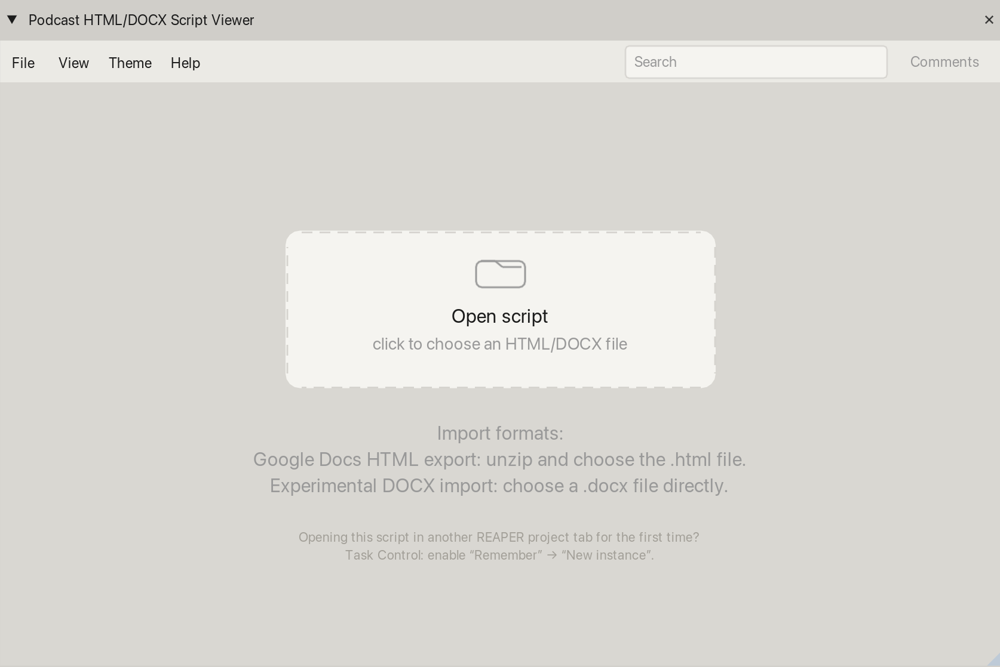
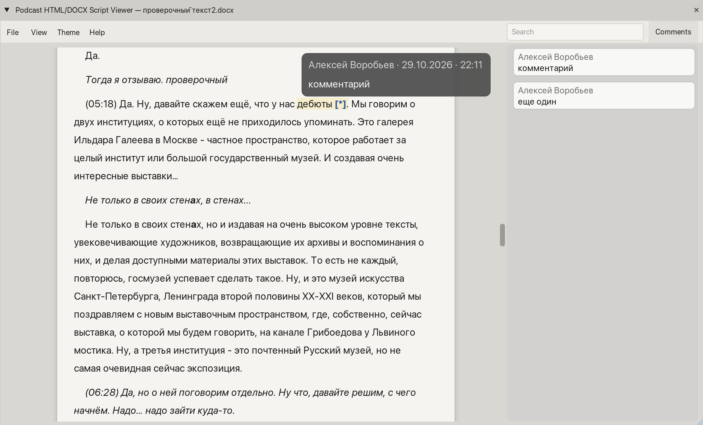
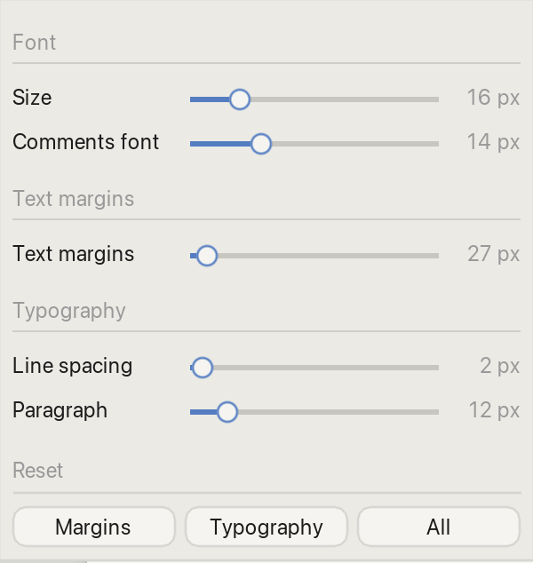

# Podcast HTML/DOCX Script Viewer

**Read your scripts inside REAPER without switching to Word or a browser.**

A script reader for podcast editing, voiceover, and audio post-production. Opens DOCX files and HTML exported from Google Docs.

[Русская версия](README_RU.md)

## Features

- Displays text with essential formatting: **bold**, *italic*, underline, text colors, and highlights.
- Shows document comments and lets you jump to them from the **Comments** sidebar.
- Searches the full document, highlights matches, and moves between individual occurrences.
- Lets you adjust font size, margins, spacing, and page layout. Includes **Pages**, **REAPER Grey**, and **Google Docs White** themes.
- Remembers the document path and reading preferences separately for each REAPER project on this computer.

## Installation

Requires **REAPER 7+** and **ReaImGui 0.10+** (available through ReaPack). No SWS extension or document converter is needed.

1. Copy `Podcast_HTML_DOCX_Script_Viewer.lua` into the `Scripts` folder inside your REAPER resource directory. To find it, use **Options → Show REAPER resource path in explorer/finder**.
2. Open **Actions → Show action list…** and choose **New action → Load ReaScript…**.
3. Select the Lua file, then run **Patch34: Podcast HTML/DOCX Script Viewer**. You can assign a keyboard shortcut in the action list.

**To update**, replace the Lua file without changing its name or location. Your existing shortcut will keep working.

## Opening a document

On first launch, the viewer opens without a document. Use **Open** in the empty window, or choose **File → Open HTML/DOCX…**.

- **DOCX:** open a `.docx` file directly.
- **Google Docs:** choose **File → Download → Web Page (.html, zipped)**, unzip the download, and open the `.html` file.

## Reading and comments

The script appears in a scrollable reading view with supported text formatting. Click **Comments** to open the sidebar and navigate to comments in the document.

Use **Search** to find a word or phrase. Matches are highlighted without hiding the rest of the document, and the counter shows your current position and the total number of matches.

## Adjusting the view

Open **View** to change text size, margins, and line or paragraph spacing. Use **Theme** to choose between **Pages**, **REAPER Grey**, and **Google Docs White**.

## Controls

| Action | Control |
| --- | --- |
| Find text | Type a word or phrase in **Search** |
| Next match | **Enter** |
| Previous match | **Shift+Enter** |
| Resize document text | **Ctrl/Cmd + mouse wheel** over the document, or **View** |
| Adjust reading layout | **View** and **Theme** menus |
| Show or hide comments | **Comments** button |

Search navigation stops at the first and last match rather than wrapping around.

## Good to know

The viewer is **read-only**. It remembers the file path but does not embed the document in your REAPER project. If you move the source file, you will need to open it again.

This tool is designed mainly for **text-based scripts**. Complex DOCX layouts, tables, images, and some Word features may not render fully or at all. Visual pages are for comfortable reading, not an exact reproduction of Word's pagination.

---

Aleksei Vorobev / [Patch34](https://github.com/patch-34) · [Support development](https://boosty.to/patch34/donate)
