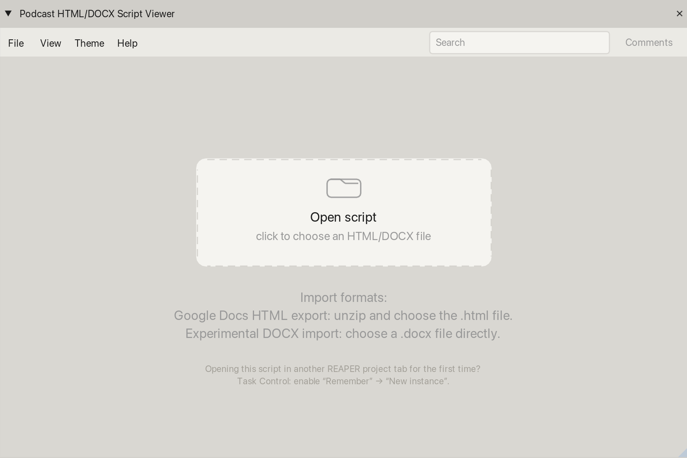
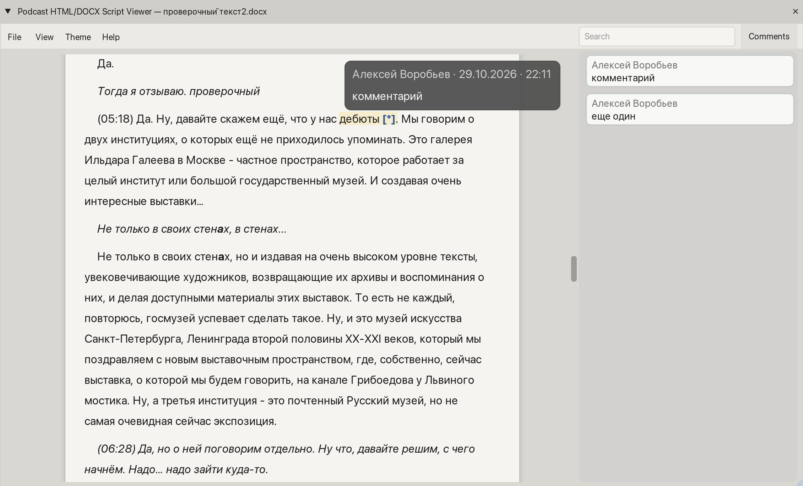
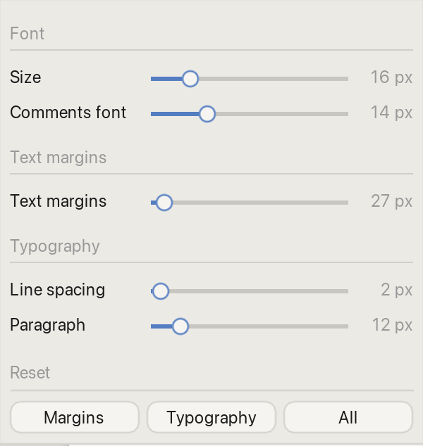

# Podcast HTML/DOCX Script Viewer

**Сценарий прямо в REAPER — без переключения на Word или браузер.**

Скрипт позволяет читать тексты подкастов, озвучивания и других аудиопроектов во время монтажа. Открывает DOCX и HTML, экспортированный из Google Docs.

[English](README.md)

## Возможности

- Показывает текст с основным форматированием: **жирный**, *курсив*, подчёркивание, цвета и выделения.
- Отображает комментарии к документу и позволяет переходить к ним из боковой панели **Comments**.
- Ищет текст по всему документу, подсвечивает совпадения и переключается между ними.
- Позволяет настроить размер шрифта, отступы, интервалы и оформление страницы. Есть три темы: **Pages**, **REAPER Grey** и **Google Docs White**.
- Запоминает открытый файл и настройки чтения отдельно для каждого проекта REAPER на этом компьютере.

## Установка

Понадобятся **REAPER 7+** и **ReaImGui 0.10+** (устанавливается через ReaPack). SWS и конвертеры документов не нужны.

1. Скопируй файл `Podcast_HTML_DOCX_Script_Viewer.lua` в папку `Scripts` каталога ресурсов REAPER. Путь к нему можно открыть через **Options → Show REAPER resource path in explorer/finder**.
2. Открой **Actions → Show action list…** и выбери **New action → Load ReaScript…**.
3. Укажи Lua-файл и запусти **Patch34: Podcast HTML/DOCX Script Viewer**. При желании назначь горячую клавишу.

**Для обновления** просто замени Lua-файл, не меняя его имя и расположение: назначенная горячая клавиша сохранится.

## Как открыть сценарий

Сразу после запуска открывается пустое окно просмотрщика. Нажми **Open** в нём или выбери **File → Open HTML/DOCX…**.

- **DOCX:** открой обычный `.docx` напрямую.
- **Google Docs:** выбери **Файл → Скачать → Веб-страница (.html, ZIP)**, распакуй архив и открой файл `.html`.

## Чтение и комментарии

Сценарий отображается с поддерживаемым форматированием. Кнопка **Comments** открывает боковую панель комментариев, из которой можно переходить к соответствующим местам в тексте.

В поле **Search** можно найти слово или фразу. Совпадения подсвечиваются, остальной текст остаётся видимым, а счётчик показывает текущее и общее количество совпадений.

## Настройка отображения

В меню **View** можно изменить размер текста, поля, межстрочный и межабзацный интервалы. Через **Theme** можно переключаться между **Pages**, **REAPER Grey** и **Google Docs White**.

## Управление

| Действие | Как выполнить |
| --- | --- |
| Найти текст | Введи слово или фразу в **Search** |
| Следующее совпадение | **Enter** |
| Предыдущее совпадение | **Shift+Enter** |
| Изменить размер текста | **Ctrl/Cmd + колесо мыши** над документом или меню **View** |
| Настроить вид | Меню **View** и **Theme** |
| Показать или скрыть комментарии | Кнопка **Comments** |

На первом и последнем совпадениях переход останавливается: поиск не переключается циклически.

## Важно знать

Просмотрщик **не изменяет исходный документ**. Он запоминает путь к файлу, но не встраивает сам документ в проект REAPER: если переместить файл, его придётся открыть заново.

Скрипт предназначен прежде всего для **текстовых сценариев**. Сложная вёрстка DOCX, таблицы, изображения и некоторые элементы Word могут отображаться неполно или не отображаться совсем. Визуальные страницы служат для удобства чтения и не повторяют разметку страниц Word.

---

Aleksei Vorobev / [Patch34](https://github.com/patch-34) · [Поддержать разработку](https://boosty.to/patch34/donate)
